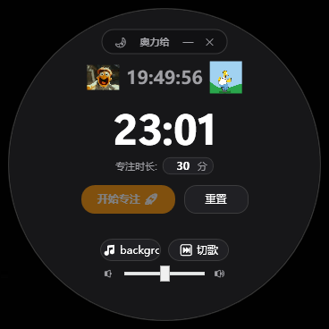
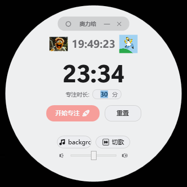

# 奥力给 (aoligei) - 桌面圆形专注悬浮球

一款趣味、治愈且富有激情的 Windows 桌面端**圆形专注倒计时（番茄钟）悬浮工具**。

告别死板沉闷的方形窗口，以精致的圆形悬浮表盘与灵动控制岛，陪伴你度过每一次高效专注时光。

---

## 专注三部曲

1. **开始专注** -> 随机大喊一声“奥利给！”，激情打气拉满战斗力！
2. **倒计时开始** -> 边做牛马边听自选背景音乐（支持一键切歌、音量随心调节）。
3. **倒计时结束** -> 播放夸奖语音，自我催眠“今天也是好棒棒的一天”！

---

## 界面展示

支持三种外观模式，一键平滑热切换：

| 深色模式 | 浅色模式 | 跟随系统 |
| :---: | :---: | :---: |
|  |  |  |
| 深邃沉浸 · 暗夜护眼 | 纯净清爽 · 雅致明亮 | 智能感知 · 与 Windows 联动 |

---

## 核心特性

- **纯圆悬浮表盘**：打破传统方形边框拘束，350px 黄金尺寸，拟物立体光影，支持按住圆盘任意空白处平滑拖拽移动（始终置顶）。
- **顶部灵动控制岛**：顶部内敛式胶囊工具栏，将模式切换、最小化与关闭按钮安全收纳于弧线内部，关闭按钮更带精致悬停红光交互。
- **亮暗主题自适应**：
  - **深色模式**：高不透明度深灰底色，彻底去除噪点杂色，纯净沉浸。
  - **浅色模式**：高亮通透微透质感。
  - **跟随系统**：自动感知 Windows 系统亮暗设定并实时响应。
- **双播放器音频系统**：
  - 提示音（开始打气、结束表扬）与背景音乐双通道独立控制；
  - 智能支持 `.mp3`、`.wav`、`.flac`、`.aac` 等主流格式；
  - 自动换曲、随机播放与“这首不好听”一键切歌。
- **双牛马动图陪跑**：实时系统时钟两侧配置跑步动画，陪伴你的每一次打拼。

---

## 使用说明

1. **开箱即用**：项目已内置精选默认歌单，克隆运行后直接点击 **【开始专注】** 即可体验（便携版运行请确保 `resource` 资源文件夹与 `aoligei.exe` 在同级目录下）。如需更换，点击底栏 **【默认歌单】** 按钮选择任意本地音乐文件夹即可。
2. **设定时长**：在圆心下方输入想要的专注时长（默认 30 分钟）。
3. **开始打卡**：点击醒目的 **【开始专注】** 按钮，听完打气口号后即可沉浸工作！
4. **随时重置 / 切歌**：
   - 觉得音乐不搭调？点击 **【切歌】** 随机切换下一首；
   - 想提前结束？点击 **【重置】** 即可归零恢复。
5. **切换主题**：点击顶部胶囊左侧的图标（🌙 / ☀️ / 💻）即可在三套主题间无缝切换。

---

## 许可证

本项目采用 [CC BY-NC-SA 4.0 (知识共享-署名-非商业性使用-相同方式共享 4.0 国际许可协议)](./LICENSE) 开源发布。

- 允许个人免费学习、研究和非商业日常使用；
- 严禁任何个人、团队或企业将本项目用于任何形式的商业转售、付费打包、付费社群分发或商业营利行为。

